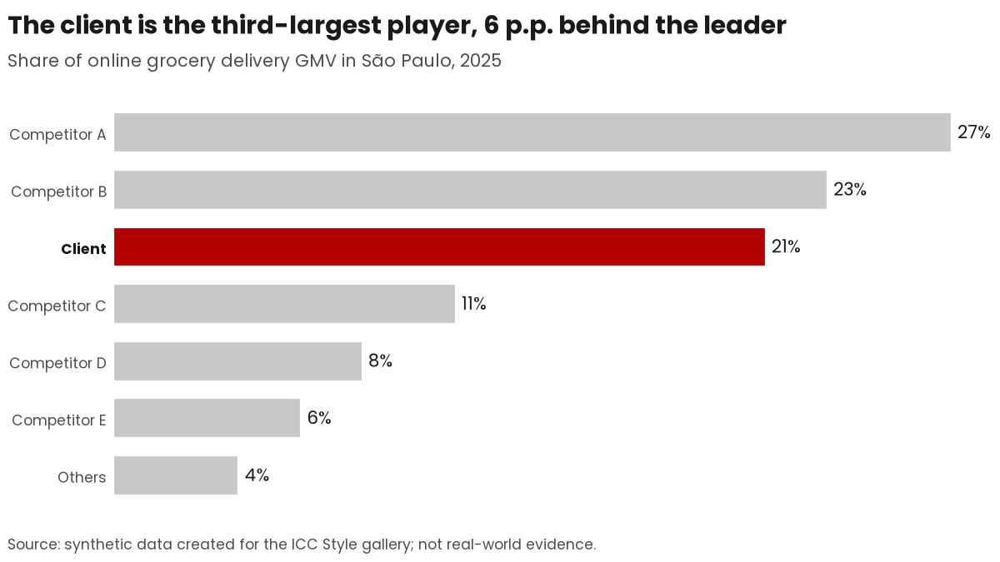
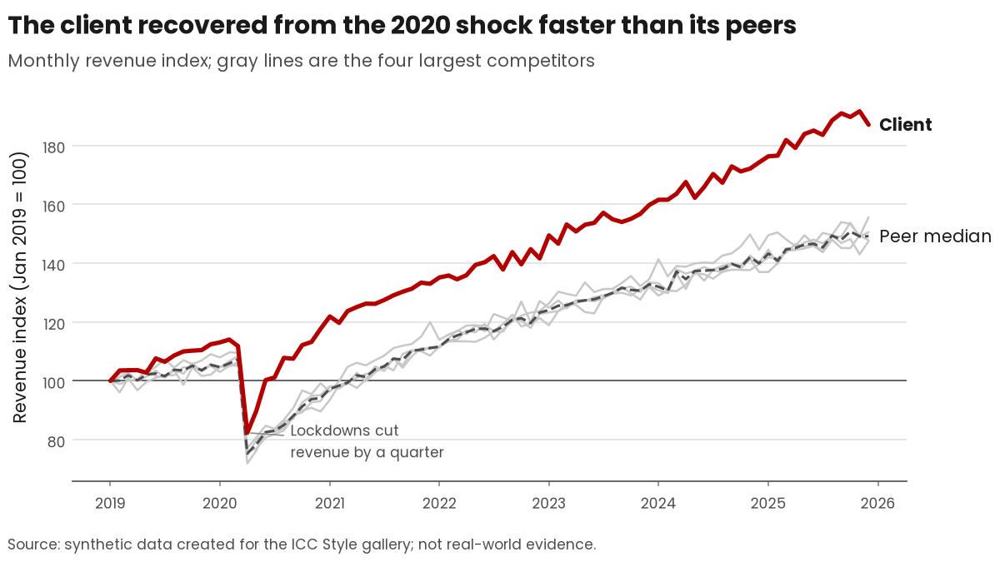
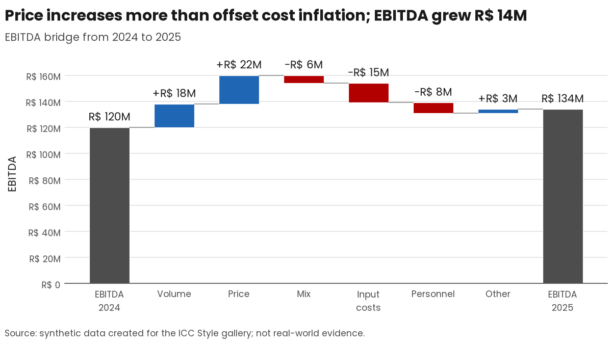
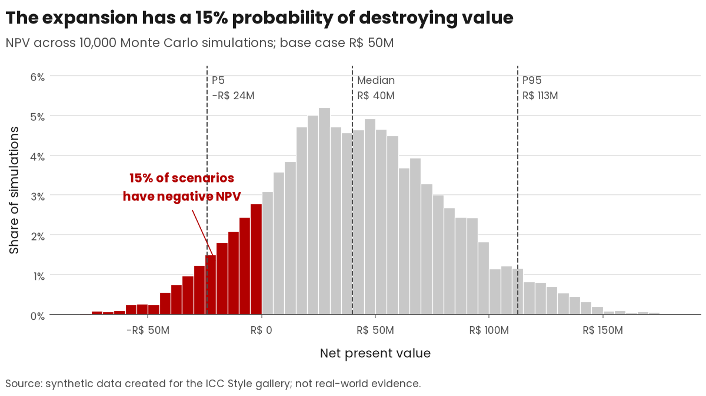
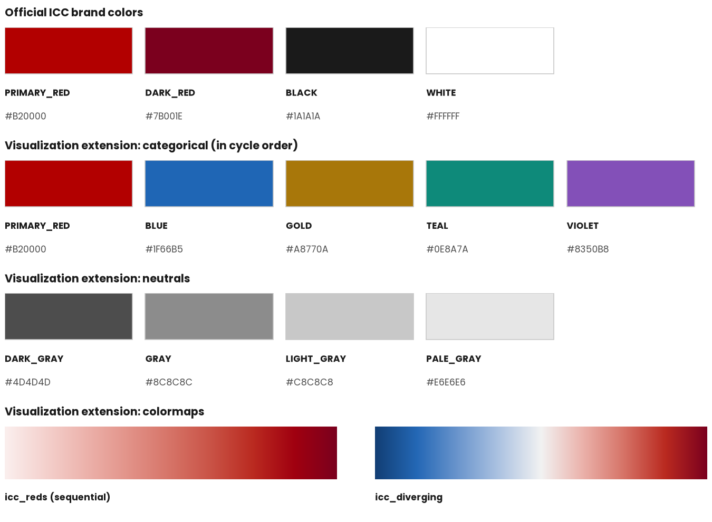

# ICC Style

ICC Style applies the visual identity of the [Insper Consulting Club](https://github.com/insper-consulting-club) to Python charts. It is a Matplotlib theme: after one call, ordinary Matplotlib and Seaborn code produces charts in the ICC fonts and colors, with defaults suited to consulting, financial and economic analysis. The package also includes a few helpers for number formatting, titles and source notes, and export.

<p>
  
  
  
  
</p>

All charts above use synthetic data. See the [example gallery](examples/gallery.ipynb).

## Installation

ICC Style needs Python 3.11 or newer and Matplotlib 3.9 or newer. Seaborn is optional.

```bash
pip install git+https://github.com/insper-consulting-club/icc-style.git
# with Seaborn:
pip install "icc-style[seaborn] @ git+https://github.com/insper-consulting-club/icc-style.git"
```

The package is not published on PyPI.

## Quick start

```python
import matplotlib.pyplot as plt
import icc_style as icc

icc.set_theme()

fig, ax = plt.subplots()
ax.plot([2022, 2023, 2024, 2025], [100, 112, 119, 135])
ax.set_xticks([2022, 2023, 2024, 2025])
ax.set_xlabel("Year")
ax.set_ylabel("Revenue index (2022 = 100)")

icc.finalize_figure(
    fig,
    title="Revenue grew 35% in three years",
    subtitle="Revenue index, 2022 = 100",
    source="Source: ICC analysis.",
)
icc.save_figure(fig, "revenue.png")
plt.show()
```

`set_theme()` registers the bundled Poppins fonts and applies the ICC style to every figure created afterwards. Everything else is standard Matplotlib.

## Google Colab

Install the package in the first cell, then use it as above:

```python
%pip install git+https://github.com/insper-consulting-club/icc-style.git
```

The fonts are bundled with the package, so nothing has to be installed on the Colab machine. To run [the gallery](examples/gallery.ipynb) in Colab, upload it and uncomment its first code cell, which contains the install command.

## Contexts

A context adapts sizes to where the chart will be seen. Colors and fonts are the same in all three.

| Context | Use | Figure size | Base font | Line width |
|---|---|---|---|---|
| `"default"` | Notebooks and general analysis | 8 × 4.5 in | 10 pt | 2.0 pt |
| `"presentation"` | Slides and projection | 10 × 5.625 in (16:9) | 14 pt | 3.0 pt |
| `"publication"` | Articles, reports, the ICC website | 6.3 × 3.9 in (A4 text width) | 9 pt | 1.5 pt |

```python
icc.set_theme("presentation")  # for the rest of the session

with icc.theme_context("publication"):  # temporarily
    fig, ax = plt.subplots()
    ...
    icc.save_figure(fig, "article-chart.svg")
    plt.show()
```

`theme_context` restores the previous settings when the block ends. Create, save and show the figure inside the block, because Matplotlib reads some settings only when it draws.

### Typographic hierarchy

Sizes are relative to the base font size of the context:

| Element | Size | Weight | Color |
|---|---|---|---|
| Figure title (`finalize_figure`) | 1.44 × base | Bold | `BLACK` |
| Axes title (`ax.set_title`) | 1.2 × base | Bold | `BLACK` |
| Subtitle, axis labels, annotations | 1.0 × base | Regular | `DARK_GRAY` / `BLACK` |
| Tick labels, legend, source note | 0.83 × base | Regular | `DARK_GRAY` / `BLACK` |

Only titles are bold. Use bold elsewhere only for deliberate emphasis, such as the label of the highlighted series.

## Titles, subtitles and source notes

`finalize_figure(fig, title=..., subtitle=..., source=...)` adds a left-aligned title block at the top of the figure and a source note at the bottom, and makes room for them in the layout. Write the title as the conclusion ("Digital channels will overtake stores by 2027"), use the subtitle for the measure and units, and always cite the source. Call it last, after plotting; calling it again replaces the texts. It warns when a text is too wide for the figure.

These texts are drawn literally, so amounts such as `"From R$ 10M to R$ 12M"` need no escaping. Elsewhere, Matplotlib treats text between two `$` signs as math. If a label or annotation contains two `R$` amounts, pass `parse_math=False` (`ax.annotate(..., parse_math=False)`) or escape the sign as `R\$`.

## Colors

### Official brand colors

| Name | Hex | Role in charts |
|---|---|---|
| `PRIMARY_RED` | `#B20000` | The main series, finding or comparison |
| `DARK_RED` | `#7B001E` | Sparing emphasis; end of the sequential and diverging maps |
| `BLACK` | `#1A1A1A` | Text |
| `WHITE` | `#FFFFFF` | Backgrounds |

`icc.BRAND_COLORS` holds the same four colors in a dictionary.

### Visualization extensions

These colors are not official ICC brand colors. They are analytical extensions for charts that need more than one hue.



- **Categorical:** `CATEGORICAL = (PRIMARY_RED, BLUE, GOLD, TEAL, VIOLET)` is the default color cycle. The hues share a lightness band with the primary red, each has at least 3:1 contrast against white, and neighbors in the cycle stay distinguishable under protanopia and deuteranopia. The first four are also mutually distinguishable, which matters in scatterplots, where any two series can meet. For more than five series, group the smallest into "Other" or use small multiples.
- **Neutrals:** `DARK_GRAY`, `GRAY`, `LIGHT_GRAY` and `PALE_GRAY` are for secondary text, context series, de-emphasized bars and shaded regions.
- **Colormaps:** `"icc_reds"` (`SEQUENTIAL_CMAP`) runs from very light red to `DARK_RED` for magnitudes, and is the default for `imshow` and heatmaps. `"icc_diverging"` (`DIVERGING_CMAP`) runs from blue through a neutral gray to red, for deviations from a meaningful midpoint. Both are interpolated at equal perceptual-lightness steps. Reversed versions are available as `"icc_reds_r"` and `"icc_diverging_r"`.

### Using color well

- Use red for the one thing the chart is about and draw context in gray. A chart where every series is red has no emphasis. The [gallery](examples/gallery.ipynb) follows this pattern throughout.
- Do not rely on color alone. Label lines and bars directly, and differentiate a benchmark or forecast with a dashed line. The categorical hues have similar lightness, so they cannot be told apart in grayscale print. For print, use red-versus-gray emphasis, line styles and labels.
- Use a sequential map only for quantities and the diverging map only when the midpoint means something. Pin the limits (`vmin`, `vmax`, `center`) so that color intensity means the same thing across charts.

## Formatting numbers

Each helper returns a Matplotlib formatter. Use it on an axis, or call it on a single value for labels and annotations:

```python
ax.yaxis.set_major_formatter(icc.brl_formatter(compact=True))  # R$ 1.5M
ax.bar_label(bars, fmt=icc.percent_formatter(decimals=0))  # 12%
label = icc.brl_formatter(decimals=0, compact=True, scale=1e6)(150)  # 'R$ 150M'
```

| Function | Example output |
|---|---|
| `number_formatter()` | `1,234,567` · `1.5M` (`compact=True`) · `(1,234)` (`negative="parentheses"`) |
| `brl_formatter()` | `R$ 1,250` · `R$ 2.5M` · `−R$ 300` · `R$ 1,2 mi` (`locale="pt-BR"`) |
| `percent_formatter()` | `12.5%` from `0.125`; use `scale=1` if data are already in percent |
| `bps_formatter()` | `125 bps` from `0.0125`; `scale=1` for data in basis points; `unit="p.b."` |

Shared options: `decimals`, `signed=True` (`+5%`), `negative="minus" | "parentheses"`, `scale` (multiply values before formatting, e.g. `scale=1e6` for data stored in millions) and `locale="en" | "pt-BR"` (`1,234.5` or `1.234,5`). Negative values use a true minus sign (−) unless `axes.unicode_minus` is off.

On an axis, the default `decimals=None` uses as few decimals as the ticks need, the same for every tick (`0.5%, 1.0%, 1.5%`). For data labels, set `decimals` explicitly to avoid spurious precision.

## Fonts

The package bundles Poppins Regular and Poppins Bold (unmodified, from [Google Fonts](https://github.com/google/fonts/tree/main/ofl/poppins)) and registers them with Matplotlib's font manager when `icc_style` is imported. Nothing is installed on the system and Matplotlib's font cache is not changed. This works the same locally, in Colab and from an installed wheel.

- Titles use Poppins Bold. All other text uses Poppins Regular.
- `icc.check_fonts()` reports the files Matplotlib actually resolves for each weight, for example `{'regular': PosixPath('.../Poppins-Regular.ttf'), 'bold': ...}`. A `None` value means that weight is unavailable.
- If registration fails or Poppins cannot be resolved, `set_theme()` emits a `UserWarning` and Matplotlib falls back to DejaVu Sans. `icc.register_fonts()` raises `icc.FontRegistrationError` with a diagnostic message.
- Glyphs that Poppins lacks, such as Greek letters and arrows, are drawn from DejaVu Sans.
- Math text (`$R^2$`) uses Poppins for letters and digits.

If Poppins is also installed on your system, Matplotlib may use that copy. The result is the same font.

## Using the style sheet directly

The theme's declarative part is a native Matplotlib style sheet, usable without `set_theme()`:

```python
import matplotlib.pyplot as plt

plt.style.use("icc_style.styles.icc")
# With a context:
plt.style.use(["icc_style.styles.icc", "icc_style.styles.presentation"])
```

Loading it by this dotted name imports `icc_style`, which registers the bundled fonts. If you copy the `.mplstyle` file elsewhere, Poppins must be installed on the system: a style sheet cannot register fonts by itself. The sheet does not set the default colormap, because `"icc_reds"` is defined in Python. Everything else matches `set_theme()`.

## Seaborn

Seaborn's plotting functions use the active Matplotlib settings, so they follow the theme with no extra setup:

```python
import seaborn as sns
import icc_style as icc

icc.set_theme()
sns.regplot(data=df, x="spend", y="revenue", color=icc.PRIMARY_RED)
sns.heatmap(corr, cmap="icc_diverging", vmin=-1, vmax=1, center=0)
```

`sns.set_theme()`, `sns.set_style()` and `sns.set_context()` overwrite fonts, colors and sizes. If you use them, call `icc.set_theme()` afterwards. For the `seaborn.objects` interface, which does not read global settings, pass the theme explicitly: `so.Plot(...).theme(icc.rc_params())`.

## Customization

Change individual settings after the theme, or pass them to `set_theme`:

```python
icc.set_theme(rc={"figure.figsize": (7, 7), "axes.grid.axis": "both"})
```

Some chart types need local adjustments, as the gallery shows:

- Horizontal bars: `ax.grid(False, axis="y"); ax.grid(True, axis="x")`.
- Scatterplots: `ax.grid(True, axis="both")`.
- Heatmaps: `ax.grid(False)`.

`icc.rc_params(context)` returns the theme as a dictionary, for `matplotlib.rc_context` or other tools. To return to Matplotlib's defaults, run `matplotlib.style.use("default")`.

The theme never changes axis limits. Bars start at zero because Matplotlib anchors them there. Line charts may use a non-zero range. Label the axis and, for indexes, draw the base line (`ax.axhline(100)`).

## Exporting figures

```python
icc.save_figure(fig, "figures/revenue.png")  # one file
icc.save_figure(fig, "figures/revenue", formats=("png", "svg", "pdf"))  # several
```

| Option | Default | Notes |
|---|---|---|
| `dpi` | 300 (`savefig.dpi`) | Raster (PNG) resolution. Vector formats ignore it. |
| `transparent` | `False` | `True` removes the white background, e.g. for colored slide backgrounds. |
| `svg_text` | `"path"` | `"path"` turns text into outlines: identical in every browser, not editable. `"text"` keeps editable, smaller text, but viewers without Poppins substitute another font. |
| `bbox_inches` | `None` | `None` keeps the exact figure size. `"tight"` crops to content and changes the size. |

PDF files embed Poppins as TrueType, so text stays selectable and editable in Illustrator or Inkscape. PDF and SVG files carry no timestamp, so re-running a script produces byte-identical files. Extra keyword arguments go to `Figure.savefig`.

Which format to use:

- **Slides (PowerPoint, Google Slides):** PNG from the `presentation` context at 200–300 dpi, inserted at its native 16:9 size.
- **Website articles:** SVG with `svg_text="path"`, or PNG at 200 dpi, from the `publication` context.
- **Reports and LaTeX:** PDF from the `publication` context.
- **Further editing by a designer:** PDF, or SVG with `svg_text="text"`.

## Example gallery

[`examples/gallery.ipynb`](examples/gallery.ipynb) is organized by analytical purpose: comparing alternatives, change over time, financial performance, relationships, uncertainty, and communicating a conclusion. The last section includes a slide and a Portuguese-language article chart. Every example uses plain Matplotlib or Seaborn on synthetic data and exports its figure to [`examples/figures/`](examples/figures).

## API reference

| Name | Purpose |
|---|---|
| `set_theme(context="default", *, rc=None)` | Apply the theme globally |
| `theme_context(context="default", *, rc=None)` | Apply the theme inside a `with` block |
| `rc_params(context="default")` | The theme as a dictionary of rcParams |
| `CONTEXTS` | `("default", "presentation", "publication")` |
| `finalize_figure(fig, *, title, subtitle, source)` | Figure title block and source note |
| `save_figure(fig, path, *, formats, dpi, transparent, svg_text, bbox_inches)` | Export |
| `number_formatter`, `brl_formatter`, `percent_formatter`, `bps_formatter` | Tick and label formatters |
| `register_fonts()`, `check_fonts()`, `FontRegistrationError` | Font registration and diagnostics |
| `PRIMARY_RED`, `DARK_RED`, `BLACK`, `WHITE`, `BRAND_COLORS` | Official brand colors |
| `BLUE`, `GOLD`, `TEAL`, `VIOLET`, `CATEGORICAL` | Categorical extensions |
| `DARK_GRAY`, `GRAY`, `LIGHT_GRAY`, `PALE_GRAY`, `NEUTRALS` | Neutral extensions |
| `SEQUENTIAL_CMAP`, `DIVERGING_CMAP` | Colormaps (`"icc_reds"`, `"icc_diverging"`) |

## Development

```bash
git clone https://github.com/insper-consulting-club/icc-style.git
cd icc-style
python -m pip install --upgrade pip              # dependency groups need pip >= 25.1
python -m pip install --group dev -e .

ruff check . && ruff format --check .
python -m pytest                                 # includes executing the gallery
python -m pytest -m "not slow"                   # skips the gallery
python -m build                                  # sdist and wheel in dist/
```

The font tests inspect the rendered output in addition to checking registration. They also run in a subprocess with an empty home directory and Matplotlib cache, which simulates a fresh machine without Poppins installed. CI runs them on Python 3.11–3.14, on the oldest supported Matplotlib, and on Windows and macOS. It also tests the built wheel in a clean virtual environment and executes the gallery.

To regenerate the gallery figures, open the notebook in Jupyter and run all cells. The figures are written to `examples/figures/`, relative to the notebook.

## License

The ICC Style source code is released under the [BSD 3-Clause License](LICENSE). Copyright (c) 2026, Liga Insper Consulting Club.

The name and visual identity of the Liga Insper Consulting Club are not licensed separately by this project. In line with clause 3 of the license, the name of the organization may not be used to endorse or promote derived products without prior written permission.

The bundled Poppins font files are © 2020 The Poppins Project Authors (<https://github.com/itfoundry/Poppins>). They are distributed unmodified under the [SIL Open Font License, Version 1.1](src/icc_style/fonts/OFL.txt), which permits bundling them with software. The OFL applies to the font files only, not to the ICC Style code.

ICC Style takes inspiration from [SciencePlots](https://github.com/garrettj403/SciencePlots), [unhcrpyplotstyle](https://github.com/unhcr-dataviz/unhcrpyplotstyle) and [bbcstyle](https://github.com/ale-tom/bbcstyle), but contains none of their code.
